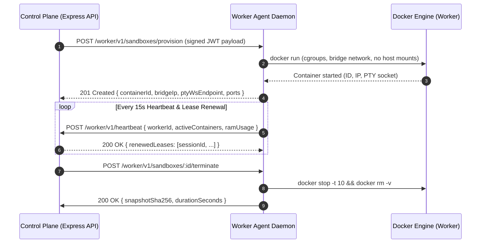
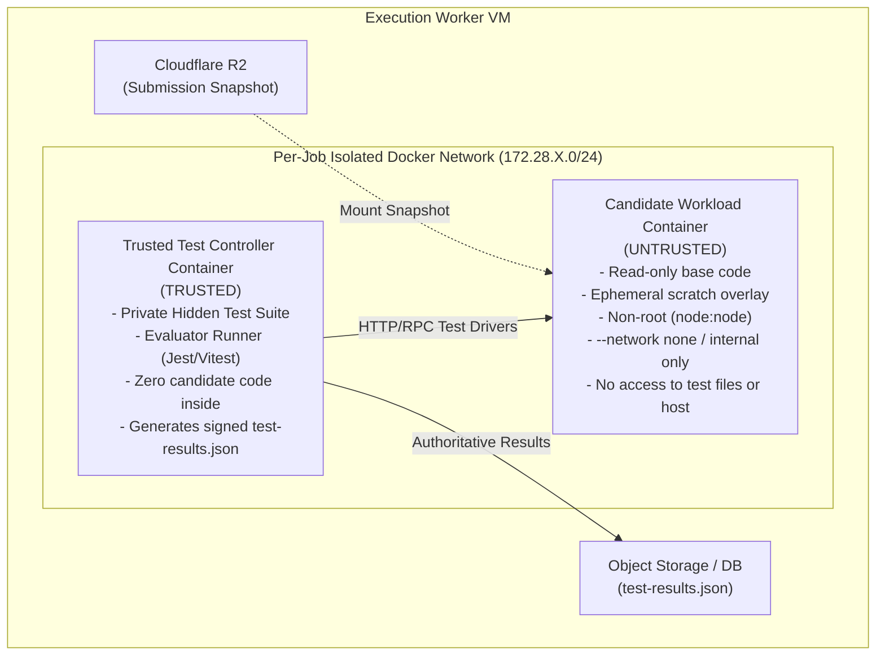
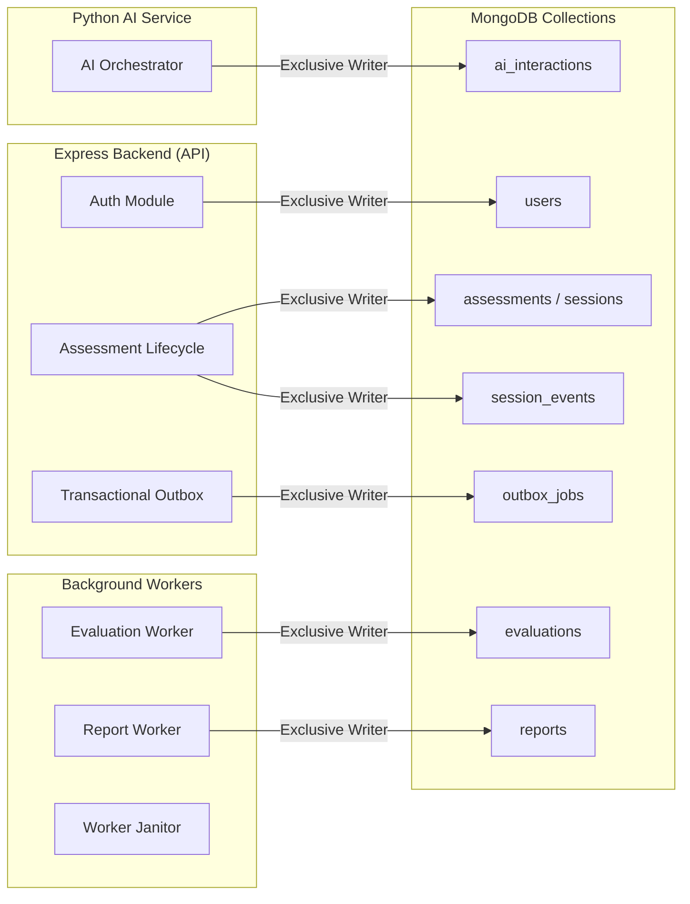

# RepoDojo — Implementation Contracts & Architectural Prerequisites

> **Status:** Authoritative Engineering Prerequisite  
> **Master Reference:** [ADR-001-all-domains-master.md](file:///D:/RepoDojo/docs/adr/ADR-001-all-domains-master.md)  
> **SDLC Reference:** The New SDLC With Vibe Coding (May 2026) — Harness Engineering & The Factory Model  

Before writing feature implementation code, these five non-negotiable engineering contracts define the interface boundaries, security walls, data ownership rules, failure modes, and physical capacity constraints of RepoDojo.

---

## 1. Infrastructure Contract: Control-Plane VM ↔ Execution-Worker Agent

The trusted **Control-Plane VM** (Express API + Python FastAPI) communicates with the dedicated **Execution-Worker VM** (Docker Host) over an authenticated, encrypted private control plane.



### 1.1 Transport & Authentication
- **Transport:** HTTPS on internal private port `8443` or wireguard/overlay network.
- **Authentication:** Dual-sided signed internal tokens. Every control-plane request carries header:
  `X-RepoDojo-Internal-Auth: Bearer <HMAC-SHA256 JWT>` containing `{ workerId, action, targetSessionId, exp: now + 30s }`.
- Replay attacks are prevented via mandatory unique UUID `X-Correlation-ID` and timestamp verification (rejecting drift > 5s).

### 1.2 Authoritative Worker Agent REST Endpoints

| Method | Endpoint | Request Payload | Response | Description |
|---|---|---|---|---|
| `POST` | `/worker/v1/sandboxes/provision` | `{ sessionId, candidateId, challengeImage, resourceLimits, env }` | `{ containerId, bridgeIp, ptyWsEndpoint, ports, expiresAt }` | Allocates isolated container with ephemeral scratch volume. |
| `POST` | `/worker/v1/sandboxes/:id/terminate` | `{ reason: 'SUBMITTED' \| 'TIMED_OUT' \| 'ABANDONED', snapshotToR2: boolean }` | `{ containerId, terminatedAt, snapshotUri, checksum }` | Gracefully terminates container and flushes final disk snapshot. |
| `GET` | `/worker/v1/sandboxes/:id/status` | — | `{ status, cpuUsage, ramUsage, pids, lastHeartbeat }` | Inspects live container cgroup statistics and responsiveness. |
| `POST` | `/worker/v1/evaluations/run` | `{ submissionId, challengeVersion, snapshotUri, testSuiteVersion }` | `{ evaluationJobId, status: 'RUNNING' }` | Spawns isolated evaluation runner and trusted test controller. |
| `POST` | `/worker/v1/heartbeat` | `{ workerId, availableRamMb, availableCpu, containerCount }` | `{ acknowledged: true, activeLeaseIds: string[] }` | Bidirectional health and lease synchronization. |

### 1.3 Lease & Watchdog Rules
- Containers are labeled with `repodojo.session_id`, `repodojo.expires_at`, and `repodojo.worker_id`.
- If the Worker Agent loses network connectivity with the Control Plane for > 60 seconds, the local **Janitor Daemon** uses the hard expiration label on the container (`repodojo.expires_at`) to self-terminate workloads, preventing orphaned container leaks.

---

## 2. Evaluation Security Contract: Trusted Test Controller vs. Candidate Workload

Candidate code is untrusted and potentially adversarial. The evaluation infrastructure strictly isolates the **execution under test** from the **authoritative test driver**.



### 2.1 Isolation Guarantees
1. **Physical Container Separation:** The private evaluation test suite is **never** copied, mounted, or made accessible inside the candidate container.
2. **Filesystem Boundaries:**
   - Candidate submission snapshot from Cloudflare R2 is mounted into the candidate workload as a **read-only base** with a tmpfs/ephemeral writable scratch overlay.
   - The candidate workload cannot inspect the Test Controller filesystem, environment variables, or memory.
3. **Network Confinement:**
   - The candidate container runs with general internet egress **completely disabled** (`--network none` for unit tests, or connected strictly to an isolated internal bridge network for full-stack API tests).
   - In full-stack API assessments, the Candidate Workload is an HTTP server listening on private port `5000`. The Test Controller acts as an HTTP client executing assertions against `http://candidate-workload:5000`.
   - Candidate code has no route to the host, cloud metadata (`169.254.169.254`), or external internet.
4. **Authoritative Results Pipeline:**
   - Candidate npm scripts (e.g. `npm test`) are **never executed** for official grading.
   - The Test Controller executes its own trusted test runner, captures individual assertion results, computes SHA-256 hashes of the output, and directly transmits `test-results.json` to the Evaluation Orchestrator.

---

## 3. Data Ownership Contract: Single-Writer Architecture

To eliminate split-brain states, race conditions, and corrupted data across the distributed MERN + Python + Redis architecture, every data store, collection, queue, and volume has an unambiguous, single authoritative writer.



### 3.1 Data Ownership Matrix

| Resource | Type | Exclusive Writer | Readers | Lifecycle / Retention |
|---|---|---|---|---|
| `users` | MongoDB | Express Auth Service | All platform services | Permanent account record |
| `assessments` / `sessions` | MongoDB | Express Assessment Lifecycle Module | Web client, Evaluation worker | 90 days post-assessment |
| `challenges` | MongoDB | Challenge CI/CD Sync Script | Express, Python AI service | Immutable per version tag |
| `ai_interactions` | MongoDB | Python FastAPI AI Service | Express, Evaluation worker | 90 days (sanitized, zero secrets) |
| `evaluations` | MongoDB | Evaluation Worker | Report worker, Express API | Permanent immutable score |
| `reports` | MongoDB | Report Generation Worker | Express API, Candidate Web | Permanent (shareable via token) |
| `outbox_jobs` | MongoDB | Express API (via Mongo transaction) | Outbox Dispatcher Worker | Deleted upon BullMQ confirmation |
| `session_events` | MongoDB | Express WebSocket Gateway | Evaluator review dashboard | 30 days retention |
| `process-evaluation` | BullMQ (Redis) | Outbox Dispatcher | Evaluation Worker pool | Transient queue (FIFO) |
| `generate-report` | BullMQ (Redis) | Evaluation Worker | Report Worker | Transient queue |
| `snapshots/` | Cloudflare R2 | Worker Snapshot Agent | Evaluation Runner | 90 days retention |
| `graphify/` | Cloudflare R2 | Challenge CI Pipeline | Python AI service | Immutable per challenge version |
| Candidate Volume | Docker Volume | Candidate & Worker Agent | Evaluation snapshot generator | Ephemeral (destroyed post-submit) |

---

## 4. Failure Recovery Contract: Deterministic Failure Procedures

Every failure mode must have a deterministic recovery path that preserves candidate work and prevents ghost state.

### 4.1 Worker VM Crash during Active Assessment
1. **Detection:** Control Plane misses 3 consecutive heartbeats (45s).
2. **Action:** Control Plane marks worker as `DEGRADED`.
3. **Session State:** Session status remains `IN_PROGRESS`; the authoritative expiration deadline (`expiresAt`) continues ticking.
4. **Rehydration:** When the candidate refreshes or worker recovers:
   - Worker allocates fresh container on available capacity.
   - Replays latest 60-second incremental workspace snapshot from Cloudflare R2.
   - PTY terminal reconnects to new shell; candidate resumes with at most 60 seconds of unpersisted file edits lost.

### 4.2 Upstash Redis Outage / Job Eviction
1. **Guaranteed Storage:** Express uses the **Transactional Outbox Pattern**. When a submission occurs, the evaluation job is written into MongoDB's `outbox_jobs` in the same atomic transaction as the session status transition `SUBMITTING → QUEUED`.
2. **Recovery:** An independent outbox dispatcher polls `outbox_jobs` where `status = 'PENDING' AND updatedAt < now - 2m`.
3. **Re-enqueue:** If Redis drops a job or crashes, the dispatcher safely re-enqueues the job into BullMQ with the same idempotent `submissionId` key.

### 4.3 Temporary MongoDB Unavailability
1. **Active Workspaces:** Containers on the execution worker continue running uninterrupted (Docker runtime does not depend on MongoDB).
2. **Editor & Terminal:** Candidate continues editing in Monaco and running commands in xterm.js.
3. **Client Queueing:** The React frontend queues file-save operations in local browser `IndexedDB`.
4. **Reconnection:** Once MongoDB reconnects, queued saves are flushed with monotonic workspace revisions.

### 4.4 Interrupted Submission / Network Loss at Expiration
1. **Timer Expiration:** Server-side background worker detects `now >= expiresAt` regardless of whether the candidate's browser is connected.
2. **Auto-Submit:** Server transitions status to `TIMED_OUT → SUBMITTING`.
3. **Snapshot Trigger:** Control Plane calls Worker Agent to freeze container and upload final snapshot to Cloudflare R2.
4. **Outcome:** Outbox creates evaluation job. When the candidate reconnects hours later, their completed evaluation and report are already waiting for them.

---

## 5. Resource Capacity Contract: Sandbox Concurrency & Admission Limits

Physical constraints of the **Oracle Cloud Always Free ARM64 Execution Worker VM**:
- **Hardware Profile:** 1 OCPU (1 Ampere A1 ARM Core), 8 GB RAM, 200 GB Block Storage.

### 5.1 Sandbox Mathematical Capacity Budget

```
Total Worker Physical RAM:                     8,192 MB (8.0 GB)
Less Host OS + Kernel + Docker Daemon:        -1,536 MB (1.5 GB)
Less Worker Agent Daemon + Janitor:             -256 MB (0.25 GB)
----------------------------------------------------------------
Total Usable Workload Capacity:                6,400 MB (6.25 GB)

Per-Sandbox Hard Allocation:
  - RAM Limit (--memory):                        768 MB
  - RAM Reservation (--memory-reservation):      512 MB
  - CPU Quota (--cpus):                          0.15 OCPU
  - PID Limit (--pids-limit):                    128
  - Ephemeral Disk Scratch Volume:               1,500 MB

Calculated Upper Limit: 6,400 MB / 768 MB = 8.3 Containers
```

### 5.2 Admission Control Policy
- **Maximum Active Concurrent Sandboxes:** **5 Candidate Containers + 1 Evaluation Runner**.
- **Headroom Buffer:** 1.8 GB RAM reserved strictly for burst compilation, test execution spikes, and the ephemeral evaluation runner.
- **Admission Queue:** When active sandboxes reach **5**, subsequent assessment start requests return HTTP `429 / 202 Queued`:
  ```json
  {
    "status": "QUEUED",
    "queuePosition": 2,
    "estimatedWaitSeconds": 480,
    "message": "All assessment sandboxes are currently occupied. You are next in queue."
  }
  ```

### 5.3 Benchmarking Requirement Before Launch
Before public release, an automated load benchmark (`scripts/benchmark-concurrency.ts`) must run on the worker:
1. Spawns 1, 3, 5, and 8 concurrent full-stack Node.js containers.
2. Executes simultaneous `pnpm run build` and `npm test` loops.
3. Measures:
   - Terminal PTY keystroke latency (target: `< 50ms`).
   - Host CPU load average and memory swap thrashing.
   - Container OOM kill occurrences.
Only if the 5-container benchmark sustains `< 50ms` latency and 0 OOM kills is the admission semaphore opened to candidates.
