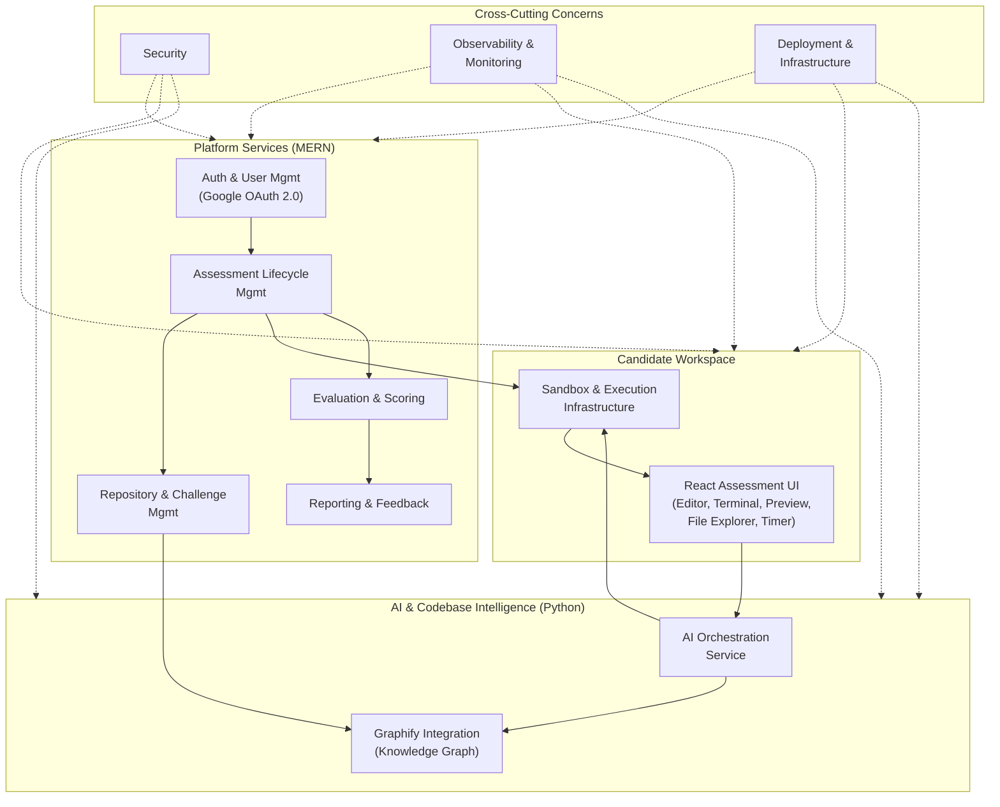
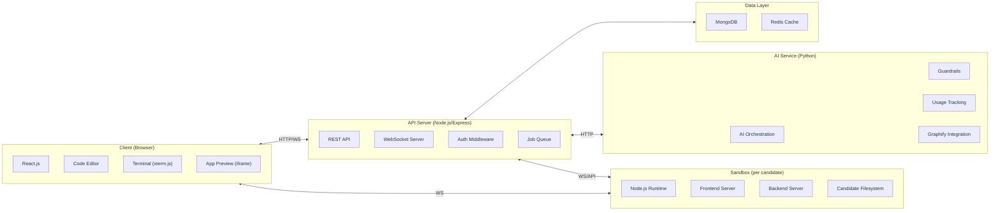

# RepoDojo — Project Kickoff & Phase 1 Roadmap

> **Train on real codebases. Prepare for real engineering.**

---

## Product Summary

RepoDojo is an AI-powered, repository-based online assessment practice platform. Candidates receive a full-stack Node.js codebase with 8 deliberately introduced logical defects, explore and fix them within ~60 minutes using an integrated AI assistant, and receive a detailed performance report evaluating both their solutions and how effectively they used AI.

---

## Domain Architecture Map

---

## 15 Development Domains

| # | Domain | Phase | Key Dependencies |
|---|--------|-------|-----------------|
| 1 | Product Requirements & Architecture | 1 | — |
| 2 | Local Dev Environment & Project Setup | 1 | Domain 1 |
| 3 | Authentication & User Management | 2 | Domain 2 |
| 4 | Assessment Lifecycle Management | 2–3 | Domains 3, 5, 6 |
| 5 | Repository & Challenge Management | 2–3 | Domain 2 |
| 6 | Sandbox & Execution Infrastructure | 3 | Domain 5 |
| 7 | Candidate Workspace & Frontend | 4 | Domains 6, 5 |
| 8 | AI Agent Integration | 5 | Domains 6, 9 |
| 9 | Codebase Intelligence & Graphify | 5 | Domain 5 |
| 10 | Evaluation & Scoring | 6 | Domains 4, 8 |
| 11 | Reporting & Feedback | 6 | Domain 10 |
| 12 | Platform Security | Cross-cutting | All |
| 13 | Observability & Monitoring | Cross-cutting | All |
| 14 | Deployment & Infrastructure | 7 | All |
| 15 | Assessment Integrity & Proctoring | Future | Domains 4, 10 |

---

## Phase 1 — Requirements & Architecture: Breakdown

Phase 1 is where we are now. It focuses on research, decisions, and project scaffolding — **zero production code** until foundations are solid.

### 1A. Architecture Research & Decisions

> [!IMPORTANT]
> Each decision below requires research, alternatives comparison, and documented rationale before selection.

| Decision Area | Key Questions | Status |
|---|---|---|
| **Sandbox Technology** | Docker? Firecracker? Cloud containers (Cloud Run, Fly.io)? WebContainers? What fits free-tier? | 🔴 Not started |
| **Browser IDE/Editor** | Monaco Editor? CodeMirror 6? Theia? Open-source VS Code variant? | 🔴 Not started |
| **Browser Terminal** | xterm.js + WebSocket? How does it connect to sandbox? | 🔴 Not started |
| **AI Provider & Model** | Gemini? GPT? Claude? Open-source? Free-tier availability? | 🔴 Not started |
| **Graphify Feasibility** | Clone & evaluate. What does graph generation look like for a medium Node.js repo? Performance? | 🔴 Not started |
| **Free-Tier Hosting** | Frontend (Vercel/Netlify)? Backend (Render/Railway)? DB (MongoDB Atlas)? Python (Render)? | 🔴 Not started |
| **Sandbox Hosting** | Free-tier isolated execution? Fly.io Machines? Cloud Run? Concurrent capacity? | 🔴 Not started |
| **Auth Library** | Passport.js? NextAuth? Firebase Auth? Auth0 free tier? | 🔴 Not started |
| **Background Jobs** | BullMQ + Redis? Agenda? Free-tier queue options? | 🔴 Not started |
| **Monorepo vs Polyrepo** | Single repo with workspaces? Separate repos per service? | 🔴 Not started |

### 1B. Project Scaffolding

| Task | Description |
|---|---|
| Create `D:\RepoDojo` workspace | Root directory with organized subdirectories |
| Initialize Git repository | Main repo with `.gitignore`, `README.md`, `LICENSE` |
| Create directory structure | `/frontend`, `/backend`, `/ai-service`, `/docs`, `/infra`, `/scripts`, `/agent-instructions`, `/skills`, `/prompts`, `/evaluation`, `/graphify-config` |
| Set up agent instruction files | `AGENTS.md`, domain-specific agent instructions |
| Create architecture decision records | `/docs/adr/` directory for ADRs |
| Define initial API contracts | OpenAPI/Swagger stubs for core endpoints |
| Set up initial testing strategy | Testing framework choices, directory conventions |

### 1C. Documentation Deliverables

| Document | Purpose |
|---|---|
| System Architecture Document | High-level architecture, service boundaries, data flow |
| Technology Decision Log | Each tech choice with rationale and alternatives considered |
| API Contract Specification | Initial endpoint definitions for core services |
| Database Schema Design | MongoDB collections, relationships, indexes |
| Sandbox Architecture Proposal | Research findings, selected approach, constraints |
| Security Architecture | Threat model, trust boundaries, security controls |
| Free-Tier Capacity Analysis | Provider limits, estimated concurrent sessions, cost projections |
| Development Workflow Guide | Git workflow, branching strategy, coding conventions |
| Graphify Integration Plan | Capabilities assessment, integration architecture, limitations |

---

## Technology Stack Summary

---

## Critical Path Analysis

The **sandbox infrastructure** is the highest-risk, highest-uncertainty component. It determines:
- Whether the product is even feasible on free-tier
- How many concurrent candidates we can support
- The entire candidate experience (terminal, execution, preview)
- Security isolation model

> [!WARNING]
> Sandbox architecture research should be the **first** technical investigation. If free-tier isolated execution isn't feasible, the entire deployment strategy and possibly the product architecture need to pivot.

**Recommended investigation order:**
1. 🔴 **Sandbox feasibility** — Can we run isolated Node.js environments on free-tier?
2. 🟡 **Graphify evaluation** — Clone, test on a sample repo, assess quality and performance
3. 🟡 **AI provider selection** — Free-tier model availability, quality, cost
4. 🟢 **Frontend/editor stack** — Well-understood, lower risk
5. 🟢 **Auth & DB** — Standard MERN patterns, low uncertainty

---

## Immediate Next Steps

1. **Create `D:\RepoDojo`** directory structure and initialize the Git repository
2. **Begin sandbox architecture research** — the critical-path investigation
3. **Clone and evaluate Graphify** against a sample Node.js repo
4. **Create `AGENTS.md`** and initial agent instruction files
5. **Set up Architecture Decision Records (ADR)** template and first entries

---

## Key Risks

| Risk | Impact | Mitigation |
|---|---|---|
| Free-tier can't support sandboxed execution | Product infeasible without paid infra | Research early; explore WebContainers, serverless containers, creative alternatives |
| Graphify doesn't scale for assessment workloads | Degraded AI context quality | Evaluate early; have fallback (simple file-based context) |
| AI inference costs exceed free allowances | Limited AI assistant functionality | Token budgets, model routing, caching strategies |
| Concurrent sandbox capacity < 5 users | Unusable for practice platform | Queue system, session time limits, aggressive cleanup |
| 60-min assessment environment stability | Candidate loses work | Session persistence, auto-save, reconnection handling |
