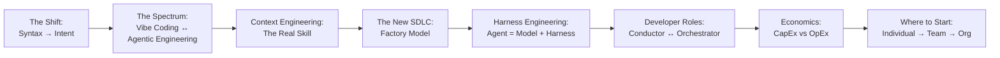
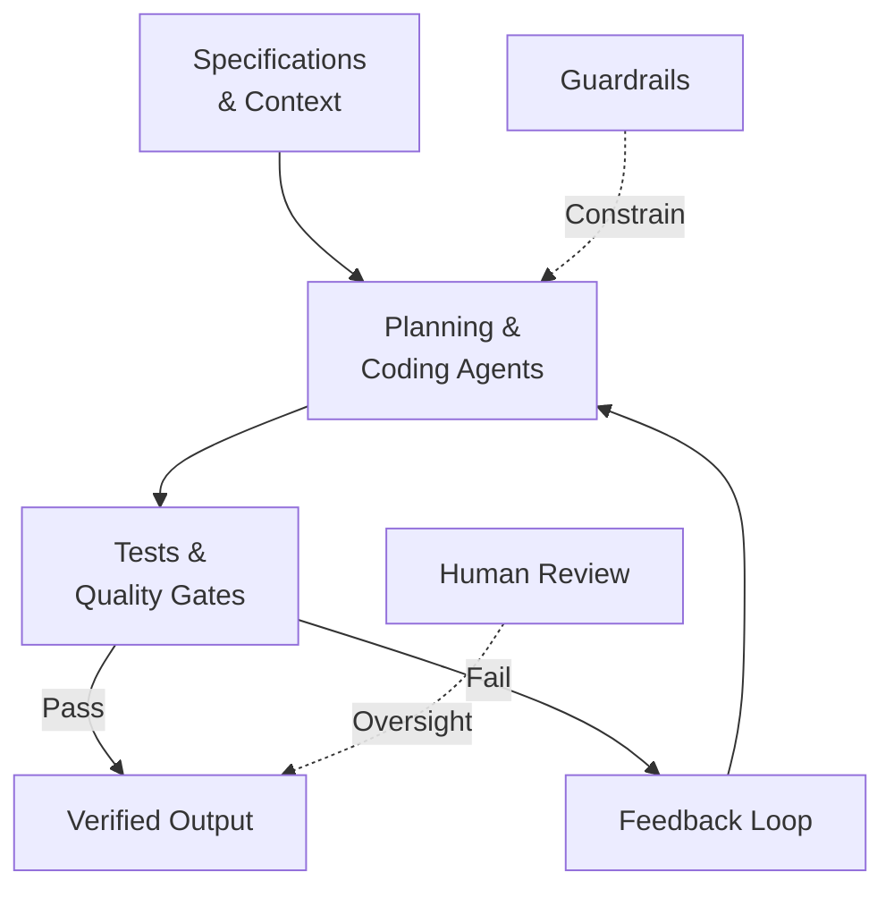

# SDLC Reference Digest — The New SDLC With Vibe Coding

**Source:** *The New SDLC With Vibe Coding — From Ad-hoc Prompting to Agentic Engineering*  
**Authors:** Addy Osmani, Shubham Saboo, Sokratis Kartakis (Google, May 2026)  
**Pages:** 51 | **Local copy:** [VibeCoding_SDLC_Google.pdf](file:///C:/Users/hp/Downloads/VibeCoding_SDLC_Google.pdf)

---

## Paper Structure at a Glance

---

## 1. Core Thesis

> *"The most profound shift in software engineering isn't a new language, framework, or cloud service. It's the transition from writing code to expressing intent, and trusting intelligent systems to translate that intent into working software."*

85% of professional developers regularly use AI Coding Agents (2026). 41% of all new code is AI-generated. The SDLC is being compressed unevenly — implementation is fast, but requirements, architecture, and verification remain human-paced.

### RepoDojo Application
RepoDojo assesses exactly this new reality: can a candidate express intent to an AI, verify its output, debug existing code, and produce correct solutions — not just write syntax from scratch.

---

## 2. The Spectrum: Vibe Coding → Agentic Engineering

| Dimension | Vibe Coding | Structured AI-Assisted | Agentic Engineering |
|---|---|---|---|
| Intent specification | Casual prompts | Detailed prompts with examples | Formal specs, architecture docs, memory files |
| Verification | "Does it seem to work?" | Manual testing, spot-checking | Automated test suites, CI/CD gates, LM judges |
| Codebase understanding | Minimal; may not read generated code | Selective review of critical paths | Comprehensive architectural review |
| Error handling | Copy-paste errors back to AI | Developer diagnoses root cause | Agents self-diagnose within bounds |
| Appropriate scope | Prototypes, scripts, hackathons | Features within established codebases | Production systems, team-scale |
| Risk profile | High; acceptable for disposable code | Moderate; human judgment at checkpoints | Low; systematic verification at every stage |

> *"The single biggest differentiator between the two ends is how outputs get verified."*

### RepoDojo Application
- **Our own development:** Operate at the Agentic Engineering end — specs, tests, guardrails, human review.
- **Candidate assessment:** Evaluate *where* on this spectrum candidates operate. Do they verify AI suggestions? Do they understand what was generated?

---

## 3. Context Engineering — The Six Types

The paper identifies context engineering as the *real skill* that separates effective AI-assisted development from ad-hoc prompting:

| Context Type | Definition | RepoDojo Application |
|---|---|---|
| **Instructions** | Agent's role, goals, operational boundaries | `AGENTS.md`, domain agent instructions, AI assistant system prompts |
| **Knowledge** | Architecture docs, diagrams, domain data | PRD, architecture docs, API contracts, Graphify graph data |
| **Memory** | Session logs (short-term) + persistent state (long-term) | Assessment session history, project decisions log, candidate interaction history |
| **Examples** | Few-shot demos, codebase reference patterns | Coding conventions, reference implementations, test patterns |
| **Tools** | APIs, scripts, external services the agent can invoke | Terminal, file operations, Graphify queries, test runners |
| **Guardrails** | Hard constraints, formatting rules, safety validations | Security policies, sandbox restrictions, file access rules, token limits |

### Static vs. Dynamic Context

| Static Context (always loaded) | Dynamic Context (loaded on demand) |
|---|---|
| System instructions | Domain-specific skill instructions |
| Rule files (AGENTS.md) | Tool results from execution |
| Global memory, persona | Documents fetched via RAG/Graphify |
| Hard constraints | Windowed session history |

> *"The best systems treat this boundary as a first-class architectural decision, reviewed and versioned like any other configuration."*

### Agent Skills — Progressive Disclosure Pattern
1. Agent sees lightweight metadata about available skills at startup
2. Task matches a skill → full instructions loaded
3. Deep reference material pulled only when explicitly needed

> *"An agent can carry dozens of specialized capabilities while paying the token cost for only the one it is actively using."*

### RepoDojo Application
- Our dev agents get domain-specific skills (sandbox engineering, security review, Graphify integration)
- Candidate AI assistant gets assessment-scoped skills (repository exploration, debugging guidance)
- Context budget is an engineering constraint, not an afterthought

---

## 4. The Factory Model

> *"The developer's primary output is not code — it's the system that produces code."*

**Key insight:** *"Success comes from giving agents success criteria rather than step-by-step instructions, then letting them iterate."*

### RepoDojo Application
- **Platform development:** We build the factory (specs → agents → tests → verified code)
- **Candidate assessment:** We evaluate whether candidates can operate within this model — give AI intent, verify output, iterate
- **Assessment itself is a factory:** Spec (problem statement) → Candidate+AI (implementation) → Tests (evaluation) → Report (output)

---

## 5. Harness Engineering

> **Agent = Model + Harness**

> *"A raw model is not an agent. It becomes one once a harness gives it state, tool execution, feedback loops, and enforceable constraints."*

| Harness Component | What It Does | RepoDojo Equivalent |
|---|---|---|
| **Instructions & Rule Files** | Defines who the agent is, what it can/cannot do | `AGENTS.md`, assessment AI system prompts, security policies |
| **Tools** | Functions, MCP servers, APIs the agent can call | Graphify MCP, terminal access, file operations, test runners |
| **Sandboxes** | Where code runs, what it can access | Candidate execution environment, isolated containers |
| **Orchestration Logic** | Sub-agent spawning, model routing, hand-offs | AI service orchestration, multi-model routing |
| **Guardrails / Hooks** | Deterministic code at lifecycle points | Pre-commit secret detection, file access restrictions, token limits |
| **Observability** | Logs, traces, evals, cost/latency metering | AI usage tracking, session tracing, cost monitoring |

### Harness Across the SDLC

| Phase | Harness Role | Activity |
|---|---|---|
| Requirements & Architecture | **Configuring** the Harness | Create AGENTS.md, define tools, set rules |
| Implementation | **Running** the Harness | Agents work within sandboxes, use provided tools |
| Testing & QA | **Feedback Loop** | Think → Act → Observe → Evaluate → Iterate |
| Code Review & Deployment | **Observing** the Harness | Hooks block bad commits, observability tracks drift |

> *"When an agent does something wrong, the first instinct is to blame the model. More often, the failure traces back to a missing tool, a vague rule, an absent guardrail, or a context window stuffed with noise. Most agent failures, examined honestly, are configuration failures."*

**Benchmark evidence:** One team moved a coding agent from outside the Top 30 to the Top 5 on Terminal Bench 2.0 by changing *only the harness* — no model change.

### RepoDojo Application
- Platform AI assistant harness = model + Graphify tools + sandbox access + guardrails + token limits + usage tracking
- Candidate-facing AI = same model, different harness (restricted tools, assessment-scoped context, monitored interactions)
- When our dev agents fail → improve the harness, not just re-prompt

---

## 6. Conductor vs. Orchestrator

| Mode | Description | When to Use | RepoDojo Application |
|---|---|---|---|
| **Conductor** | Real-time, hands-on. Developer watches code appear, guides with prompts, maintains fine-grained control | Complex debugging, unfamiliar codebases, architectural changes, critical paths | Sandbox architecture, security implementation, complex integrations |
| **Orchestrator** | Async, delegated. Define goals, assign to agents, review results | Well-defined tasks, test generation, documentation, bug fixes, migrations | Test suite generation, documentation, routine API implementation, CI setup |

> *"The risk of conductor mode is that it can become a bottleneck. The orchestrator mode requires strong skills in: specification, decomposition, evaluation, and system design."*

---

## 7. The 80% Problem

> *"AI agents can rapidly generate approximately 80% of the code for a feature, but the remaining 20% — the edge cases, error handling, integration points, and subtle correctness requirements — demands deep contextual knowledge."*

**Key evolution:** AI errors have shifted from syntax mistakes to *conceptual failures* — wrong business logic assumptions, missing edge cases, architectural decisions that create subtle long-term maintenance burdens. These are harder to detect because the code "looks right."

### RepoDojo Application
- **Assessment design:** The 8 intentionally introduced bugs should test exactly this — logical defects that "look right" but fail on edge cases
- **AI evaluation:** Measure whether candidates catch the 20% that AI gets wrong, or blindly accept suggestions
- **Our own development:** Never accept implementations just because they compile — run the full test suite, verify edge cases

---

## 8. Three Coding Agent Locations

| Location | Description | Examples | RepoDojo Usage |
|---|---|---|---|
| **In the editor** | Inline completion, chat panels, whole-codebase awareness | Copilot, Cursor, Windsurf | Candidate's in-browser editor AI assistance |
| **In the terminal** | Multi-file work, command execution, test-driven iteration | Antigravity CLI, Claude Code, Codex CLI | Our development workflow, candidate terminal access |
| **In the background** | Autonomous tasks in cloud sandboxes, produces PRs | Jules, Copilot agent mode | Assessment evaluation pipeline, report generation |

---

## 9. Economics: CapEx vs. OpEx

### Vibe Coding (Low CapEx, High OpEx)
- **Token Burn Rate:** Unstructured context dumping, expensive "prompting loops" with low first-pass success
- **Maintenance Tax:** Inconsistent AI-generated code → expensive reverse-engineering later
- **Security Remediation:** Rapid code generation = rapid vulnerability generation

### Agentic Engineering (High CapEx, Low OpEx)
- **Upfront investment:** API schemas, test suites, context engineering, AGENTS.md
- **Result:** AI operates within a governed "factory" — structurally sound, pre-tested, aligned output
- **Marginal cost per feature drops dramatically**

### Intelligent Model Routing
> *"Use large, advanced models for complex tasks (Requirements, Architecture, initial Implementation) but automatically route deterministic, lower-complexity tasks (Test Generation, Code Review, CI/CD monitoring) to smaller, faster, and significantly cheaper models."*

### RepoDojo Application
- Route complex reasoning tasks to strong models; use lighter models for test generation, formatting, routine checks
- Track token costs per assessment session
- Design the candidate AI assistant with token budgets — efficient prompting is part of the skill being assessed

---

## 10. Actionable "Where to Start" Guidance

### For Individual Developers (Our Team)
1. Set up `AGENTS.md` — start with 10 lines, add a rule every time the agent does something wrong
2. Write tests and evals *before* generating code — they are the contract with the AI
3. Review every line the agent produces that ships — be skeptical of anything "clever"
4. Maintain developer skills — AI handles routine so we focus on the challenging

### For Engineering Leaders
1. Make context engineering a first-class practice — AGENTS.md, evals, skills as versioned code
2. Set the bar at the eval, not the demo — "a working demo proves success once; a passing eval suite proves reliability"
3. Re-shape code review for AI-generated code — watch for hallucinated dependencies, inadequate error handling
4. Distinguish prototyping from production work explicitly

### For Organizations
1. Treat AI-assisted development as an engineering *investment*, not just a productivity feature
2. Build the production substrate *before* scaling — evals, traces, scoped permissions, security review
3. Adopt open standards — MCP for tools, A2A for inter-agent communication

---

## 11. Three Durable Principles

> **1. Structure scales, vibes don't.** *Vibe coding is valid for exploration. For production, agentic engineering — specs, tests, guardrails, human oversight — is not optional.*

> **2. AI amplifies your engineering culture.** *Organizations with strong testing, architecture, and review get dramatically more value. AI multiplies both strengths and weaknesses.*

> **3. The human role is evolving, not diminishing.** *The most valuable engineers direct agents well, not write the most code. Generation is solved. Verification, judgment, and direction are the new craft.*

---

## Mapping to RepoDojo PRD Sections

| SDLC Concept | PRD Section(s) |
|---|---|
| Vibe Coding → Agentic Engineering Spectrum | §18.1, §18.6 |
| Context Engineering (6 types) | §18.2 |
| Static vs. Dynamic Context | §18.3 |
| Agent Skills & Progressive Disclosure | §18.4 |
| Factory Model | §18.6 |
| Harness Engineering | §18.5 |
| Conductor vs. Orchestrator | §18.9 |
| The 80% Problem | §18.10 |
| Coding Agent Locations | §18.11 |
| Intelligent Model Routing | §18.12 |
| Token Economics / TCO | §18.13 |
| Security & Guardrails | §18.14, §13 |
| Output + Trajectory Evaluation | §18.8 |
| Test-Driven Development | §18.7 |
| Continuous Harness Improvement | §18.15 |
